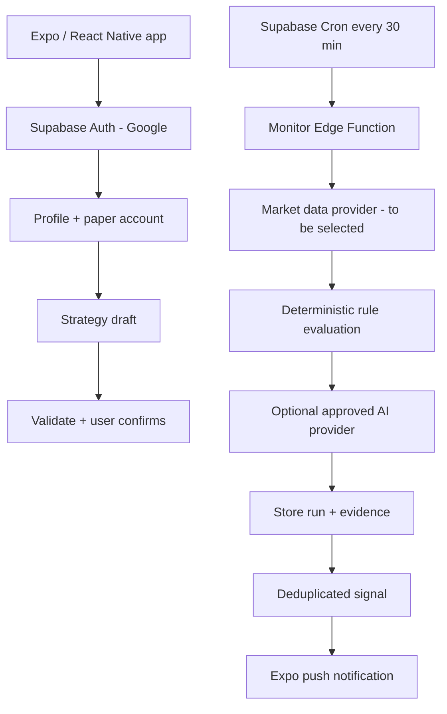

# Application Architecture

## First principle

Trading_APK is a paper-trading simulator. The phone shows screens and captures user intent; the server owns identity checks, virtual balance changes, strategy evaluation, monitoring and notifications. No real broker or live-money orders are in scope for the first release.

## Component view

## Technology choices

- **React Native, Expo, TypeScript, Expo Router:** Android-first app and file-based navigation.
- **Supabase Auth:** Google OAuth, stable user identity and session management.
- **Supabase Postgres + RLS:** profiles, paper sessions, strategies, scan history, signals and ledger entries, isolated by user.
- **Supabase RPC/Edge Functions:** operations that must validate input or update multiple rows safely.
- **Supabase Cron:** server-side schedule; mobile timers are not reliable for background monitoring.
- **Market data adapter:** hides vendor-specific APIs. A market/vendor must be selected before real monitoring is implemented.
- **AI provider adapter:** provider-specific credentials and requests stay server-side. AI can parse strategy intent and explain evidence, but cannot authorize access, change cash balances or create live trades.
- **Expo Notifications:** push delivery; in-app signal history remains the durable record.
- **EAS Build:** installable APK for preview; App Bundle for store distribution.

## Google login and profile

1. User opens the OAuth flow from the app.
2. Supabase validates the provider callback and creates a session.
3. A database trigger creates one profile row, with `profiles.id = auth.users.id`.
4. The user can edit the allowed profile preferences.
5. RLS checks `auth.uid()` on each user-owned row.

Google login is the app's primary sign-in. ChatGPT access is a separate AI-provider permission and must not be assumed from Google identity or from a ChatGPT subscription.

## Paper-money safety

- The client may request creation of a session but cannot write a balance or ledger record directly.
- `create_paper_session` is a database function that validates the amount and creates both the session and the opening ledger row in one transaction.
- Cash is stored as integer minor units, such as paise for INR.
- Trades/fills and balance transitions need server-side transactional operations before they are added.
- Every signal should retain the strategy version, market source timestamp and relevant evidence.

## Strategy and monitoring lifecycle

A prompt is saved as a draft. Before activation, an authorized AI parser (once configured) must produce a structured specification that passes application validation; the user sees a plain-language preview and confirms it. Unsupported or ambiguous conditions stay in draft status.

The cloud monitor is scheduled every 30 minutes. It reads active strategies, fetches current data, checks freshness, evaluates deterministic conditions, optionally uses an approved AI provider, records an outcome and creates a deduplicated notification event. The job must not rely on the Android app being open. Every scan records `MATCH`, `NO_MATCH` or `INSUFFICIENT_DATA`; errors and stale data must never be reported as a match.

**Current scaffold limitation:** real market data, strategy activation, AI inference, scheduled deployment and Expo push delivery are not finished. The Edge Function placeholders explicitly fail closed until provider settings and policies are implemented.

## Proposed database tables

- `profiles`: preferences owned by the auth user.
- `paper_sessions`: virtual account settings and current cash balance.
- `ledger_entries`: immutable virtual cash movements, including the opening entry.
- `strategies`: original prompt, market/symbol, version, status and validated specification.
- `monitor_runs`: each scan, status and diagnostics.
- `signals`: match outcome and evidence.
- `device_tokens`: owner-scoped Expo push tokens.
- `notification_outbox`: backend-only queue for reliable and deduplicated notification delivery.

The migration in `supabase/migrations` implements the initial set. Any further tables or RPCs need RLS, tests and clear ownership rules before production use.

## UI principles

- Light mode: warm off-white background (`#F7F5F0`), near-black text (`#111111`).
- Dark mode: near-black background (`#101010`), orange text (`#FF8A00`) and dark surfaces (`#191919`).
- Starting typography: balance 32–36, page title 24–28, section title 18–20, body 16, secondary text 14, metadata 12–13 logical units.
- Use consistent 4/8-unit spacing, generous margins, large touch targets, tabular numerals and clear loading/empty/error states.
- Validate contrast, screen reader labels and font scaling. Status is described in text, not only by color.

## Security boundaries

- Only publishable Supabase client values may use `EXPO_PUBLIC_` variables.
- Service-role keys, AI keys, OAuth secrets and refresh tokens must remain in server-side secret storage.
- All exposed user tables need RLS and cross-user tests.
- Validate both inbound strategy text and AI output; treat prompts and external market data as untrusted.
- Avoid logging personal data or credentials.

## References

- [Expo Router](https://docs.expo.dev/router/introduction/)
- [Expo + Supabase](https://docs.expo.dev/guides/using-supabase/)
- [Supabase scheduled Edge Functions](https://supabase.com/docs/guides/functions/schedule-functions)
- [Supabase Google OAuth](https://supabase.com/docs/guides/auth/social-login/auth-google)
- [Sign in with ChatGPT](https://developers.openai.com/siwc/quickstart)
